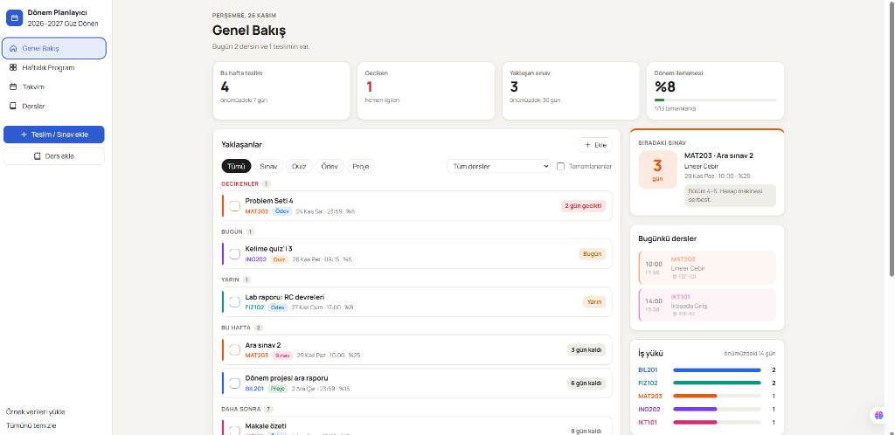
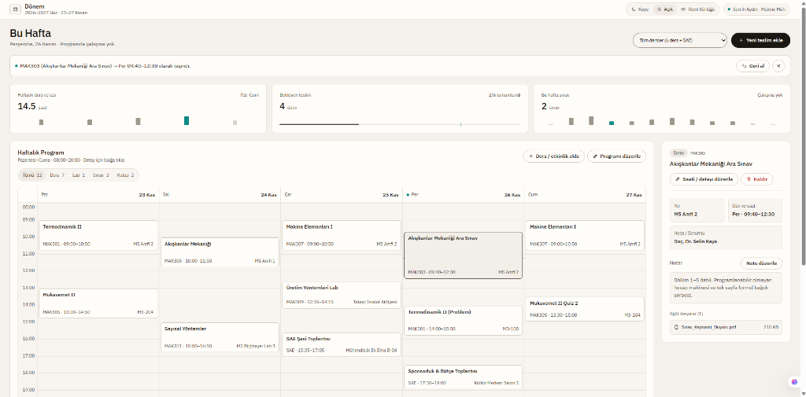

# Sonuçlarımız

> Bitirince forkunuza push edin ve fork linkinizi forma girin: **https://forms.gle/WTen8QPpZWA5A7DD7**

**Grup:** Mantra — Manifest, Sueda, Karl Marx, Sigmund Freud, Donald Trump, Tesla, Joker

| | Tur 1: Ham prompt | Tur 3: Skill + eleştiri |
| --- | --- | --- |
| Ekran görüntüsü |  |  |
| Puan (20) | 6 | 19 |

**En büyük fark neydi?** Renk tonlarının değişimi en büyük farktı.

**Skill'e eklediğimiz kurallar:**

1. Göz konforu öncelikli ekranlarda 5'li tipografi ölçeğini bir kademe büyüt (`14 / 16 / 19 / 28 / 34px`); takvim bloklarında ana başlık `16px medium (--text)`, saat/yer `14px (--text-2)` olsun.
2. Tek dolu ana aksiyon butonu (`≥ 48px`) her zaman ilk bakışta sayfa başlığının sağ üstünde dursun; haftalık programda sürükle-bırak/uzat/kısalt + ders ekleme-çıkarma + `Geri al (Ctrl+Z)` destekli Düzenleme Modu bulunsun; tüm formlarda görünür etiket + `Zorunlu / İsteğe bağlı` + yardımcı metin ve anlık doğrulama hatası yer alsın.

**Bir dahaki sefere ilk yapacağımız şey:** Önce skill'leri oluşturup sonra projeye başlamak.
